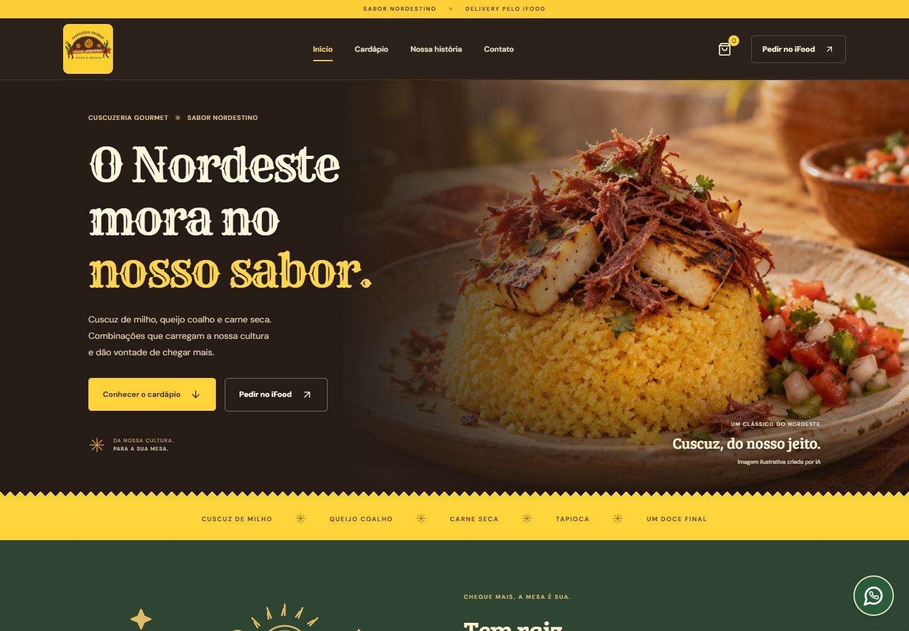
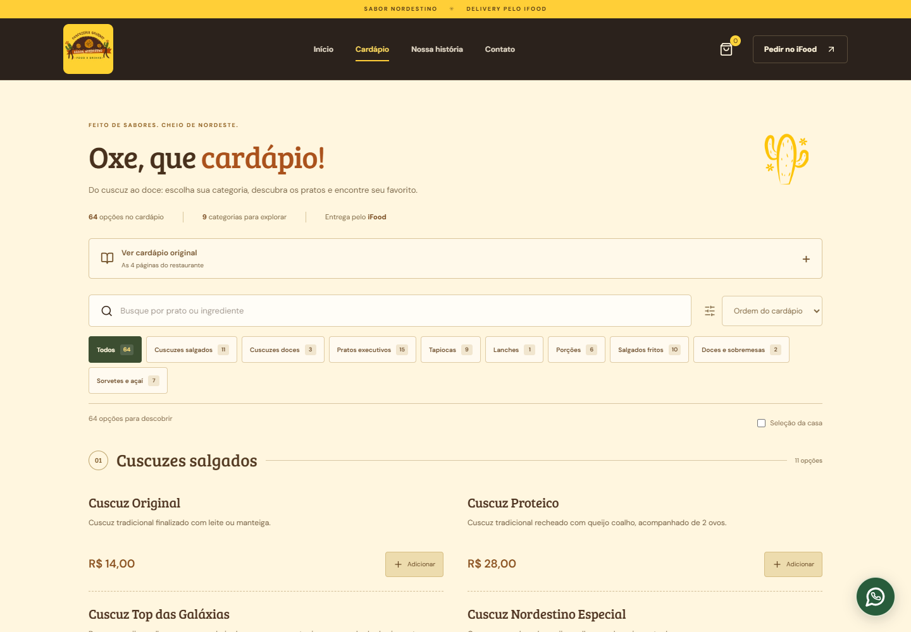
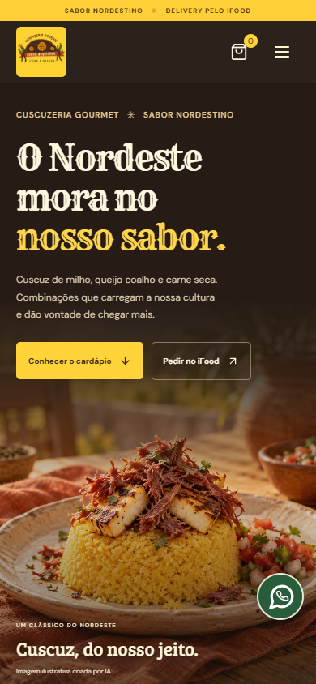
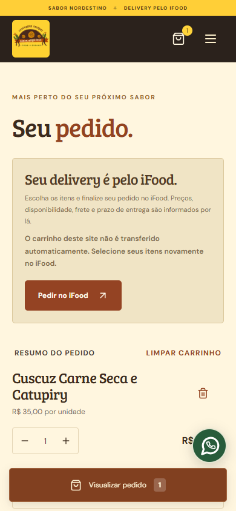

**Português** | [English](README.en.md)

# Cuscuzeria Gourmet 🌽

**Projeto de trabalho: site institucional e cardápio digital para um restaurante de culinária nordestina.**

Desenvolvi este projeto para apresentar a Cuscuzeria Gourmet na web, organizar seu cardápio e facilitar o acesso aos canais de atendimento e delivery. A proposta combina uma identidade visual inspirada no Nordeste com uma experiência responsiva para quem acessa pelo computador ou celular.

[**Acessar o site**](https://gustavobenabraham.github.io/cuscuzeria-gourmet-site/) · [Documentação de configuração](docs/CONFIGURATION.md) · [Guia de publicação](docs/DEPLOYMENT.md)



## Contexto do trabalho

O projeto foi desenvolvido em um contexto profissional, a partir das necessidades de apresentação de um negócio real. O trabalho envolveu transformar o cardápio de referência em dados estruturados, adaptar a identidade visual do restaurante para a interface, construir a navegação e preparar a aplicação para publicação.

O foco foi entregar uma presença digital com informações organizadas, acesso rápido aos produtos e integração por links com WhatsApp e iFood. A implementação atual é um frontend: o atendimento acontece nos canais externos e a aplicação não processa pagamentos nem confirma pedidos.

## Funcionalidades

- **Cardápio digital com 64 opções**, dividido em categorias, com busca que desconsidera acentos e ordenação de produtos.
- **Carrinho persistente** no navegador, com controle de quantidade, observações por item e cálculo de valores em centavos.
- **WhatsApp com mensagem preparada** a partir dos itens selecionados; o cliente confirma o envio no aplicativo.
- **Acesso ao delivery pelo iFood**. O carrinho local não é transferido automaticamente para a plataforma.
- **Layout responsivo**, com navegação adaptada para celular, tablet e computador.
- **Identidade nordestina**, com cores, ilustrações, elementos de cordel e a marca original do restaurante.
- **Acessibilidade**, incluindo navegação por teclado, foco visível, formulários identificados e suporte à redução de movimento.
- **Metadados e dados estruturados** do tipo Restaurant para descrever o negócio.
- **Configurações centralizadas** para editar cardápio, textos, rotas, identidade visual e limites do carrinho.

## Prints do projeto

Capturas reais da aplicação executada localmente. As imagens do cardápio e do carrinho mostram diferentes etapas da navegação.

### Cardápio no computador



### Experiência no celular

| Página inicial | Carrinho com um item selecionado |
| --- | --- |
|  |  |

## Tecnologias utilizadas

| Tecnologia | Aplicação no projeto |
| --- | --- |
| **React 19 + TypeScript** | Componentes reutilizáveis, estado da interface e tipos para produtos, carrinho e configurações. |
| **Vite** | Ambiente de desenvolvimento e geração da versão de produção. |
| **Tailwind CSS 4 + CSS** | Estilização, identidade visual e adaptação dos layouts. |
| **React Router** | Navegação entre início, cardápio, pedido, história e contato. |
| **React Hook Form + Zod** | Formulários e validação de dados e configurações. |
| **Motion** | Animações de entrada com respeito à preferência de movimento reduzido. |
| **Lucide React** | Ícones da interface. |
| **localStorage** | Persistência do carrinho entre acessos no mesmo navegador. |
| **Vitest + Playwright** | Testes unitários e testes de navegação em navegador real. |
| **Git, GitHub e GitHub Pages** | Versionamento, apresentação do código e hospedagem estática. |

## O que aprendi com este projeto

- **Traduzir necessidades de um negócio em funcionalidades:** organizar a apresentação do restaurante, os produtos e os caminhos para atendimento.
- **Estruturar uma aplicação React com TypeScript:** separar páginas, componentes, hooks, serviços e regras de domínio, mantendo contratos de dados claros.
- **Trabalhar com informações de uma fonte real:** conferir categorias, preços e itens do cardápio, mantendo referências para facilitar futuras revisões.
- **Gerenciar estado e persistência:** restaurar o carrinho, tratar dados inválidos, limitar quantidades e manter consistência nos cálculos monetários.
- **Validar formulários e configurações:** oferecer mensagens claras e impedir que dados incompletos sigam no fluxo.
- **Desenvolver interfaces responsivas e acessíveis:** considerar telas pequenas, navegação por teclado e preferências de movimento.
- **Integrar canais externos:** preparar mensagens para o WhatsApp e deixar claro como o fluxo do site se relaciona com o iFood.
- **Testar e publicar um frontend:** verificar regras de negócio e navegação, gerar o build e cuidar de rotas e caminhos de arquivos no GitHub Pages.

## Executar localmente

Requisitos: **Node.js 22.12 ou superior** e npm. Projeto validado com Node.js 24.

```bash
git clone https://github.com/GustavoBenAbraham/cuscuzeria-gourmet.git
cd cuscuzeria-gourmet
npm ci
npm run dev
```

Abra o endereço informado pelo Vite, normalmente `http://127.0.0.1:5173`. No Windows, use `npm.cmd` se o PowerShell bloquear o comando `npm`.

| Comando | Finalidade |
| --- | --- |
| `npm run dev` | Iniciar o ambiente local. |
| `npm test` | Executar os testes unitários. |
| `npm run build` | Verificar os tipos e gerar `dist/`. |
| `npm run preview` | Visualizar o build localmente. |
| `npm run test:e2e` | Executar testes no navegador; requer Google Chrome instalado. |
| `npm run check` | Executar testes unitários, build e testes de navegador. |
| `npm run build:pages` | Gerar o build com os caminhos do GitHub Pages. |
| `npm run test:pages` | Verificar a versão preparada para o GitHub Pages. |

## Organização do código

```text
src/
├── components/   # Layout, produtos e elementos reutilizáveis
├── config/       # Cardápio, textos, marca, rotas e validações
├── data/         # Dados de domínio expostos para a aplicação
├── hooks/        # Estado e persistência do carrinho
├── pages/        # Início, cardápio, carrinho, história e contato
├── services/     # Interface de acesso ao catálogo
├── styles/       # Estilos globais, marca e identidade regional
├── types/        # Tipos compartilhados
└── utils/        # Cálculos, sanitização e mensagens de WhatsApp
public/           # Imagens, ícones e arquivos estáticos
tests/            # Testes de navegação e do GitHub Pages
docs/             # Prints e documentação de apoio
scripts/          # Publicação e prévia do GitHub Pages
```

## Qualidade e decisões técnicas

Os testes unitários verificam cálculos, recuperação de dados do carrinho, limites, configurações e montagem das mensagens. Os testes de navegador exercitam busca, navegação, persistência, validação e layouts em diferentes tamanhos de tela, sem enviar mensagens ao restaurante.

O catálogo fica em `src/config/catalog.json`. A camada `catalogService` permite evoluir o acesso a dados para uma API. A aplicação atual não possui backend, autenticação, estoque em tempo real ou processamento de pagamentos. Disponibilidade, taxas e condições de entrega são determinadas pelo iFood.

A fotografia principal de cuscuz é uma **imagem ilustrativa gerada por IA**, identificada na interface. A origem dos materiais e as referências do cardápio estão documentadas em [fontes e conferência](docs/SOURCES.md) e [procedência da imagem](docs/IMAGE-PROMPT.md).

## Documentação complementar

- [Configuração e manutenção do conteúdo](docs/CONFIGURATION.md)
- [Build, rotas e publicação](docs/DEPLOYMENT.md)
- [Fontes do cardápio e informações do negócio](docs/SOURCES.md)
- [Procedência da imagem ilustrativa](docs/IMAGE-PROMPT.md)

## Autor e uso dos materiais

Desenvolvido por [**Gustavo Ben Abraham**](https://github.com/GustavoBenAbraham), como projeto de trabalho para a **Cuscuzeria Gourmet**.

A marca, o logotipo e os materiais do restaurante pertencem aos seus respectivos titulares. A disponibilização pública deste repositório apresenta o trabalho realizado e não concede, por si só, uma licença de reutilização desses materiais.
